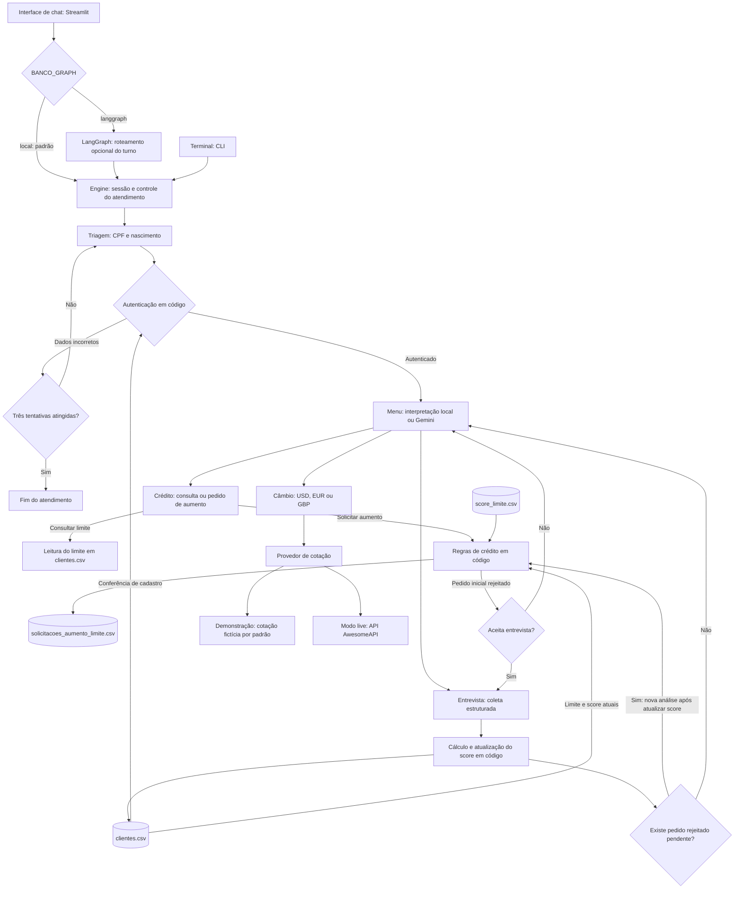
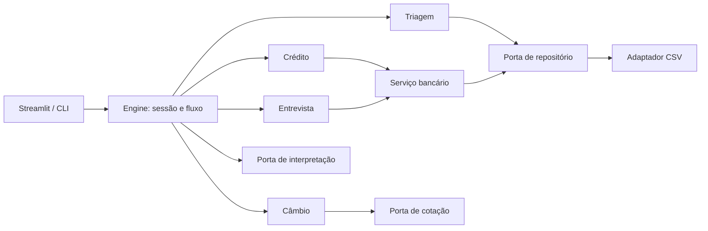

# Banco Ágil

Atendimento bancário fictício com quatro responsabilidades: triagem, crédito, entrevista de crédito e câmbio. O modelo interpreta intenções; regras bancárias são executadas e verificadas em código. A entrega inicial é um monólito modular com interfaces para evolução de armazenamento e serviços.

**Autor:** Carlos Bonfatti · © 2026 Carlos Bonfatti.

Projeto desenvolvido para avaliação técnica de candidatura. É permitida a análise e a execução local para essa finalidade. Não é concedida autorização ampla para redistribuição, publicação de versões derivadas ou uso comercial. Consulte os [termos de uso](LICENSE). A disponibilização pública não impede tecnicamente a cópia do código.

## Guia da documentação

| Documento | Conteúdo |
|---|---|
| [Arquitetura](docs/ARCHITECTURE.md) | Separação de responsabilidades, contratos, escolhas técnicas e evolução de persistência/escalabilidade |
| [Segurança, contexto e alucinação](docs/SECURITY_AND_CONTEXT.md) | Limites de autoridade, dados enviados ao modelo, estado da sessão, fontes de verdade e riscos restantes |
| [Estratégia de testes](docs/TESTING.md) | Tipos de testes, exemplos no código, comandos de execução e limites da cobertura |
| [Evidências de validação](docs/VALIDATION.md) | Resultados registrados de testes, avaliação offline, performance e instalação |
| [Avaliação e apresentação](docs/EVALUATION.md) | Como medir qualidade/custo e demonstrar o projeto na entrevista |
| [Matriz do desafio](docs/REVIEW_FOR_SUBMISSION.md) | Requisitos, análise inicial e acompanhamento das melhorias |
| [Maturidade e entrega](docs/DELIVERY_ASSESSMENT.md) | Diferenciais demonstrados, limites e etapas restantes para apresentação |
| [Persona e interface](docs/PERSONA.md) | Identidade, tom, limites e orientação visual do Assistente Ágil |
| [Revisão antes da publicação](docs/PRE_PUBLICATION_REVIEW.md) | Gitignore, credenciais, verificações e aderência ao enunciado |

## Execução rápida

Validação real inicial: `gemini-3.5-flash-lite`, em 05/10/2026, passou nas cinco chamadas externas do smoke test. A avaliação resolveu outros 21 casos localmente e omitiu 28 pelo teto de chamadas. Isso comprova integração, não qualidade geral do modelo. Ver [relatório](docs/evaluation-gemini-smoke.json) e [limites da validação](docs/VALIDATION.md). O modo padrão continua offline e não requer chave; somente ativar Gemini gera chamadas ao provedor.

Python 3.11+ em Linux ou macOS. O repositório CSV utiliza `fcntl`, portanto Windows nativo não é suportado nesta versão (usar WSL).

```bash
python3 -m venv .venv
source .venv/bin/activate
pip install -r requirements-lock.txt
pip install -e . --no-deps
streamlit run app.py
```

Sem instalar dependências externas, o modo de terminal funciona com:

```bash
python3 -m banco_agil.cli
```

Cliente fictício: **00000000001**, nascimento **01/01/1990**, limite inicial **R$ 1.000**, score **400**. Segundo cliente: **00000000002**, **15/05/1985**. Não usar dados pessoais reais.

Os arquivos em `data/` são amostras públicas dos dados fictícios. As sementes distribuídas ficam em `banco_agil/seeds/`; um teste verifica que ambas as versões coincidem. No primeiro uso, são gravadas atomicamente em `runtime/data/`, relativo ao diretório de execução, ou em `BANCO_DATA_DIR`. O atendimento só altera a cópia de trabalho; para reiniciar os dados, remova essa pasta quando não houver processos executando. Variáveis podem ser definidas no ambiente; `.env.example` é um exemplo e não é carregado automaticamente.

## Visão geral e arquitetura

A interface utiliza fundo azul-violeta, barra de marca branca, apresentação em duas colunas, cartões de serviços e progresso da entrevista. O layout final foi aprovado pelo candidato em 05/10/2026. A saudação é calculada ao iniciar uma conversa pelo horário de Brasília: bom dia das 05h às 11h59, boa tarde das 12h às 17h59 e boa noite nos demais horários. Não depende do LLM nem coleta a localização do cliente. A configuração visual está em `.streamlit/config.toml`; iniciar Streamlit pela pasta do projeto para carregá-la.

### Fluxo do atendimento

O fluxograma abaixo apresenta as quatro responsabilidades do atendimento. Na implementação atual, elas são handlers do `Engine`. O LangGraph é opcional na interface Streamlit e encaminha cada turno ao Engine; a CLI chama o Engine diretamente. Gemini classifica intenções somente no menu, quando configurado; o modo padrão usa interpretação local.



Após consulta, cotação ou aprovação, o atendimento permanece no menu. Uma reanálise após entrevista também retorna ao menu, mesmo se rejeitada. O encerramento pode ser solicitado em qualquer etapa. Aprovar registra a decisão, sem efetivar um novo limite. Os CSVs do fluxo são as cópias de trabalho em `runtime/data/` ou no diretório configurado por `BANCO_DATA_DIR`.

### Componentes e dependências



- `domain.py`: tipos, validação monetária e fórmula de score.
- `service.py`: ferramentas com verificação de sessão autenticada.
- `engine.py`: quatro handlers e máquina de estados do atendimento.
- `ports.py`: contratos para repositório, interpretação, cotação e futura busca documental.
- `adapters/`: implementações CSV, Gemini, interpretação local e cotação.
- `graph.py`: adaptador opcional de execução de turnos em LangGraph. A máquina de estados ainda reside no Engine; não há persistência de checkpoints distribuída nesta versão.
- `app.py`: apresentação; sem fórmulas ou acesso direto aos dados bancários.

O estado de cada atendimento é isolado. Um lock de sessão impede dois turnos simultâneos. O modelo não recebe ferramenta que aceite um CPF escolhido por ele: o serviço obtém o CPF da sessão autenticada. Esses controles protegem o fluxo conversacional, mas não substituem autenticação forte de produção.

A UI oferece atalhos no menu, orientação por etapa, progresso da entrevista, cancelamento da tarefa atual e encerramento explícito. Cancelar uma tarefa preserva autenticação e pedidos já registrados. CPF, nascimento e valores coletados na entrevista são ocultados no histórico visual; outras mensagens passam por redação de padrões conhecidos. O histórico exibe até 80 mensagens e é limpo ao encerrar, expirar ou iniciar nova conversa. A expiração é verificada na próxima interação/execução da UI, sem temporizador em segundo plano.

## Funcionalidades implementadas

1. CPF e nascimento conferidos em `clientes.csv`; três tentativas com formato válido e dados que não correspondem ao cadastro encerram o atendimento. Erros de formato não consomem tentativa.
2. Consulta de limite autenticada e registro de aumento em `solicitacoes_aumento_limite.csv`.
3. Aprovação ou rejeição conforme a faixa em `score_limite.csv`.
4. Entrevista com renda, emprego, despesas, dependentes e dívidas; score arredondado e limitado entre 0 e 1000.
5. Atualização em `clientes.csv` e nova análise automática do pedido rejeitado após a entrevista.
6. Cotação USD, EUR e GBP com fonte, horário e identificação de simulação.
7. Encerramento em todas as etapas, tratamento de falhas e respostas consistentes.
8. Esclarecimento de múltiplas moedas e recusa de moedas não suportadas, sem substituí-las silenciosamente por USD.

## Demonstração e integração de IA

Padrão: `BANCO_LLM_MODE=demo` e `BANCO_FX_MODE=demo`. O interpretador é determinístico por palavras-chave, e as cotações são fictícias. **Esse modo não comprova a qualidade de um LLM.**

Para Gemini, configure no ambiente:

```bash
export BANCO_LLM_MODE=gemini
export GEMINI_API_KEY='sua-chave'
export GEMINI_MODEL='modelo-disponivel-na-sua-conta'
export BANCO_FX_MODE=live
export BANCO_GRAPH=langgraph
streamlit run app.py
```

O adaptador Gemini usa `generateContent`, resposta JSON com enumeração de intenções e validação local da estrutura, tipos, enums e uso de tokens. Saídas incompletas são recusadas. A chave vai em header, nunca na URL. Apenas a mensagem de menu é enviada; CPF contínuo, pontuado ou separado por espaços, datas reconhecíveis, emails e alguns valores financeiros são removidos. Os turnos de autenticação e entrevista não passam pelo modelo. Não há envio do histórico completo. A redação não é um detector universal de dados pessoais: usar somente dados fictícios neste exercício.

A IA classifica intenção; as respostas são templates controlados e a entrevista coleta uma resposta por vez. Ainda não há extração conversacional livre de múltiplos campos. A integração real precisa ser avaliada com um modelo disponível e uma chave; testes com respostas simuladas não comprovam qualidade nem latência do provedor.

## Segurança, qualidade e controle de consumo

Os controles, o contexto mantido pela aplicação e os limites de prevenção de informações inventadas estão detalhados em [SECURITY_AND_CONTEXT.md](docs/SECURITY_AND_CONTEXT.md), com referências ao código e às evidências.

O contrato de escopo identifica o Banco Ágil, distingue dados de outras instituições de referências legítimas a outros bancos e informa quando uma funcionalidade bancária não está disponível neste atendimento. Pedidos reconhecidos fora do escopo não consultam dados financeiros. Transferências, pagamentos e abertura de conta continuam fora das atividades implementadas.

Regras financeiras são verificadas em código. A identidade de sessão, a tabela de score e o repositório determinam os valores e decisões apresentados. Isso reduz informações inventadas, mas não garante classificação perfeita: pedidos ambíguos exigem esclarecimento e o modo demo tem um vocabulário limitado. Instruções no prompt não substituem autorização nas ferramentas.

Os CSVs são verificados por colunas, linhas incompletas e identidades duplicadas. Valores monetários persistidos precisam ser finitos, não negativos e ter precisão válida; a tabela de score deve cobrir 0 a 1000 sem lacunas ou sobreposição. Dados inválidos bloqueiam a decisão com erro controlado.

| Configuração | Padrão | Escopo |
|---|---|---|
| `BANCO_SESSION_IDLE_SECONDS` | 900 | Expiração por inatividade, inclusive em acesso direto ao serviço |
| `BANCO_MAX_LLM_CALLS_PER_SESSION` | 20 | Tentativas de chamadas externas por atendimento |
| `BANCO_MAX_LLM_CALLS_PER_ENGINE` | 200 | Tentativas por Engine compartilhado na UI |

Falhas também consomem o limite de chamadas. Encerramento e cancelamento continuam disponíveis sem LLM. Os contadores são protegidos entre threads; não há coordenação entre réplicas. Reiniciar o Engine reinicia o teto compartilhado, e abrir nova conversa reinicia o teto da sessão. Esses limites controlam quantidade de chamadas; não são um bloqueio por valor faturado nem autenticação contra força bruta.

`engine.metrics_snapshot()` informa turnos, tentativas externas, tokens reportados, erros e chamadas com uso desconhecido. Tokens de pensamento reportados pelo Gemini são somados à saída. Dados ausentes de consumo não significam custo zero. Logs não incluem mensagem, CPF, renda ou chave do provedor. O relatório de avaliação calcula estimativa apenas com tarifas explicitamente informadas e indica quando ela está incompleta.

## Escolhas técnicas e justificativas

- **Monólito modular:** menos operação e rede; fronteiras explícitas facilitam extrair componentes depois.
- **Tipos e validação em Python:** núcleo sem dependências de terceiros, executável sem internet. JSON do modelo validado por chaves e enums. Pydantic pode ser incorporado na futura API, sem obrigar o domínio a depender dele.
- **CSV:** cumpre o enunciado. Lock entre processos, escrita em temporário, `fsync` e substituição atômica evitam truncamento visível. Atualizações de score e registro de nova análise são operações separadas; não há transação entre arquivos.
- **Idempotência:** identidade de evento por sessão; registro de crédito deduplicado no CSV. Em memória, até 128 respostas recentes por sessão. Não há deduplicação de conversa após reinício ou troca de instância.
- **Money com Decimal:** conversões explícitas e limites de entrada; sem aritmética binária de dinheiro.
- **LangGraph opcional:** o mesmo domínio e fluxos podem ser testados sem o framework. O adaptador atual envolve os turnos, sem prometer recuperação durável.

### Ambiguidades resolvidas

`rejeitado` é o status canônico (o texto também usa `reprovado`). O novo limite solicitado é o **limite total**, e deve exceder o atual. Aprovação registra a decisão e **não efetiva** um novo limite, pois o enunciado não define essa etapa. O CSV inclui `request_id`, além das cinco colunas obrigatórias, para deduplicação. A tabela fornecida no projeto é sintética; substituir pela tabela da vaga, caso ela seja disponibilizada.

## Performance e redução de custo

Chamadas ao modelo apenas no menu. Autenticação, coleta estruturada, cálculo, aprovação e encerramento não usam tokens. A resposta JSON é limitada a 256 tokens; entrada até 2.000 caracteres. Falhas do provedor são visíveis, sem fallback silencioso nem tentativas ilimitadas. O cache de câmbio dura 60 segundos por processo, com fonte e horário. O modelo tem timeout de 8 segundos; a cotação, 4 segundos.

A medição local não representa latência de LLM, rede ou atendimento distribuído. Valores de custo dependem do modelo e das tarifas da conta; nenhum custo real foi presumido. O cache de cotação usa locks por moeda: uma moeda lenta não bloqueia moedas independentes, e solicitações da mesma moeda compartilham o resultado dentro do TTL. Contadores de tokens são diagnósticos locais, não um sistema de faturamento. Ver [validação](docs/VALIDATION.md), [avaliação e demonstração](docs/EVALUATION.md) e [matriz do desafio](docs/REVIEW_FOR_SUBMISSION.md).

## Desafios enfrentados e soluções

- Reenvio após recarga: identidade de evento e chave de pedido persistida.
- Escrita concorrente em CSV: lock único entre processos e troca atômica.
- Prompt malicioso: classificação não concede autoridade para aprovar ou selecionar outro cliente.
- Falhas na entrevista: preservar respostas e etapa para retentar.
- Avaliação sem credenciais: terminal e UI em modo demo, explicitamente identificado.
- Crescimento sem serviços prematuros: interfaces e plano em `docs/ARCHITECTURE.md`.

## Testes

O workflow GitHub Actions está configurado para execução **manual**, pela aba Actions → Quality → Run workflow. Push e pull request não iniciam execuções automaticamente. Essa opção preserva a cota da conta; o candidato informou ter atingido o limite de uso. A CI remota permanece sem validação registrada; as evidências de aprovação são locais, em [VALIDATION.md](docs/VALIDATION.md).

A [estratégia de testes](docs/TESTING.md) diferencia testes unitários, integração, segurança, escopo, regressão, falhas, concorrência, idempotência, UI e FinOps. As categorias podem se sobrepor. A última validação registrou 79 métodos de teste aprovados; avaliação offline, carga e instalação são verificações adicionais, com escopos distintos.

```bash
python -m unittest discover -s tests -v
ruff check .
python scripts/benchmark.py
python scripts/evaluate.py --mode demo
python scripts/benchmark_load.py
```

Testes cobrem autenticação, regras de score, reanálise, isolamento, idempotência, gravação concorrente entre processos, falha de substituição de arquivo e validação do JSON do provedor. Testes de UI e LangGraph são executados quando os extras estão instalados. CI instala os extras e verifica ambos. `requirements-lock.txt` registra as versões do ambiente local validado (Python 3.12/macOS); validar compatibilidade ao trocar de plataforma.

A suíte inclui regressões de encerramento com negação, controle de moedas, redação, sessões expiradas, limite concorrente de chamadas, reanálise após falha, aderência ao escopo e jornada completa na UI. Os testes de interface usam AppTest; ainda não há E2E em navegador real. A avaliação padrão é offline. O conjunto de 54 exemplos é uma base de regressão conhecida, não um holdout independente nem prova de qualidade em produção. A CI configurada também gera um wheel e verifica sua instalação fora do checkout; ainda não há execução remota de CI porque o projeto permanece local.

## Limitações e evolução

Esta é uma primeira implementação local, não um produto bancário pronto para produção. Não há autenticação forte, rate limiting distribuído, checkpoints persistentes, tracing centralizado, banco vetorial ou microserviços implementados. Há pontos de extensão e decisões de migração documentadas. O armazenamento CSV faz leituras completas e reescreve o arquivo de pedidos: adequado para o desafio pequeno, inadequado para volume crescente.

## Referências consultadas

- [LangGraph Graph API](https://docs.langchain.com/oss/python/langgraph/graph-api)
- [Streamlit chat input](https://docs.streamlit.io/develop/api-reference/chat/st.chat_input)
- [Gemini structured output](https://ai.google.dev/gemini-api/docs/structured-output)
- [Gemini generateContent](https://ai.google.dev/api/generate-content)
- [AwesomeAPI moedas](https://docs.awesomeapi.com.br/api-de-moedas)
