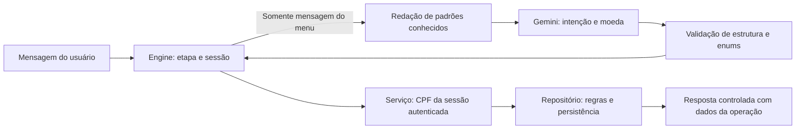

# Segurança, contexto e controle de informações inventadas

Este documento descreve os controles implementados no Banco Ágil, suas evidências e seus limites. Resultados de execução estão em [VALIDATION.md](VALIDATION.md); os tipos e procedimentos de teste estão em [TESTING.md](TESTING.md).

## Limites de confiança e autoridade

A mensagem do usuário e a resposta do modelo são entradas não confiáveis. O modelo classifica intenção e moeda; não escolhe a identidade do cliente, não calcula score, não decide aprovação e não escreve diretamente nos CSVs.

O Engine verifica o fluxo; o BankingService obtém o CPF da sessão autenticada; o repositório aplica a política financeira e persiste a decisão. O controle decisivo está no código, não apenas nas instruções do prompt. Os templates apresentam os resultados dessas operações.

O diagrama mostra o caminho financeiro com Gemini habilitado. O modo demo usa interpretação local, sem chamada externa. Câmbio utiliza uma porta separada de cotação, sem delegar ao modelo a criação de valores.

## Controles implementados

| Risco | Controle atual | Evidência e limite |
|---|---|---|
| Operação sem identidade autenticada | Serviço exige `Session.authenticated_cpf()`; acesso bloqueado após encerramento ou expiração | Testes de autenticação obrigatória e expiração no serviço; CPF/nascimento continuam sendo autenticação fictícia |
| Acesso a outro cliente por instrução do usuário/modelo | CPF vem da sessão, e não de argumento escolhido pelo modelo | Teste usa interpretador malicioso simulado; não é avaliação de resistência de um LLM real |
| Aprovação fora da regra | Repositório compara limite desejado com a faixa do score vigente | Testes de rejeição, aprovação e tentativa de ignorar regras |
| Divulgação de dados ao Gemini | Autenticação e entrevista não passam pelo modelo; mensagem de menu recebe redação | HTTP simulado verifica CPF contínuo/pontuado/com espaços, data, email e valores financeiros reconhecidos; outros padrões podem escapar |
| Divulgação no histórico visual | Entradas de CPF, nascimento, renda e despesas são ocultadas; demais mensagens passam por redação | Testes de apresentação e jornada Streamlit; a barra lateral mostra apenas o cadastro sintético de demonstração |
| Dados pessoais em logs | Logs da aplicação registram etapa, latência e tipo de falha, sem imprimir mensagens ou cadastros | Verificado no código; não houve auditoria completa de logs das dependências |
| Sessão abandonada | Expiração por inatividade, padrão de 900 segundos | Verificada antes do replay pessoal e no acesso direto ao serviço; verificação ocorre na próxima operação/execução da UI |
| Consumo externo sem limite | Reserva de tentativa antes da chamada; teto por sessão e por Engine compartilhado | Testes de concorrência e falha; limite local de chamadas, sem garantia de teto monetário ou coordenação entre réplicas |
| Reenvio ou concorrência | Identidade de evento, deduplicação persistida de pedido e locks | Garantia de resposta limitada às 128 entradas em memória; sessões não sobrevivem a reinícios |
| Base ou resposta externa inválida | Validação de JSON, enums, consumo, colunas, linhas, valores monetários e faixas | Testes recusam respostas malformadas, `NaN`, lacunas e sobreposição; não é proteção contra alteração autorizada/maliciosa de uma tabela válida |

Código principal: [service.py](../banco_agil/service.py), [session.py](../banco_agil/session.py), [engine.py](../banco_agil/engine.py), [privacy.py](../banco_agil/privacy.py), [gemini.py](../banco_agil/adapters/gemini.py) e [csv_repository.py](../banco_agil/adapters/csv_repository.py).

## Contexto da aplicação e contexto do modelo

São mecanismos distintos. A aplicação mantém estado estruturado para executar o atendimento. O modelo recebe uma mensagem isolada para interpretar a intenção no menu; não recebe uma memória conversacional completa.

| Contexto | Onde fica | Uso e ciclo de vida |
|---|---|---|
| Etapa atual | `Session.stage` | Determina qual entrada é esperada: CPF, nascimento, menu, valor ou pergunta da entrevista |
| Identidade | `pending_cpf` / `cpf` | CPF em validação ou autenticado; removido ao encerrar/expirar |
| Entrevista | `Session.interview` | Respostas tipadas acumuladas; limpas ao concluir, cancelar ou encerrar |
| Pedido rejeitado a reanalisar | `Session.desired_limit` | Mantém o valor durante a entrevista; removido após reanálise, recusa, cancelamento ou encerramento |
| Respostas para idempotência | `Session.responses` | Até 128 pares de mensagem/resposta em memória; limpos ao encerrar/expirar |
| Histórico visual | Estado da UI Streamlit | Até 80 mensagens, com mascaramento; limpo ao encerrar, expirar ou iniciar nova conversa |
| Entrada Gemini | Corpo de uma requisição | Instrução fixa e mensagem de menu redigida; sem cadastro, entrevista ou histórico completo |

O mascaramento da UI não apaga o conteúdo original de todos os componentes. CPF, respostas da entrevista e mensagens do cache podem existir em memória durante a sessão. Limpar estruturas também não constitui garantia de eliminação forense da memória do processo. CSVs de trabalho permanecem em disco após o encerramento.

Após entrada inválida, a etapa permanece disponível para correção. Falhas transitórias não entram no cache de resposta; uma falha durante a reanálise preserva o estado para nova tentativa. Atualizar score e registrar a nova decisão são duas operações separadas, sem transação entre arquivos.

Não há compreensão comprovada de referências livres como “quero aquele valor”, “a outra moeda” ou “como falei antes”. O fluxo resolve campos pela etapa, mas a classificação no menu não vê mensagens anteriores. Também não há extração livre de múltiplos campos da entrevista, persistência de sessão ou checkpoints duráveis LangGraph.

## Informações inventadas e erros de interpretação

O objetivo é apresentar somente valores e decisões sustentados pelas ferramentas. A implementação reduz o espaço de geração livre, mas não promete zero alucinação nem classificação perfeita.

| Resultado apresentado | Fonte de verdade | Proteção atual |
|---|---|---|
| Limite disponível | Cadastro do cliente autenticado | Leitura pelo serviço e formatação monetária em código |
| Score atualizado | Fórmula determinística da entrevista | `Decimal`, arredondamento definido e resultado limitado a 0–1000 |
| Aprovação/rejeição | Score atual e tabela de limites | Regra executada e decisão registrada pelo repositório |
| Cotação | Provedor configurado | Moeda, fonte, referência temporal e identificação explícita de simulação |
| Direcionamento | Interpretador + políticas do Engine | Estrutura validada e esclarecimento quando a intenção é ambígua |

Validação de JSON prova formato e valores permitidos, não que o modelo compreendeu o pedido. Uma intenção válida ainda pode estar errada. O modo demo também pode errar por ter vocabulário e regras limitados.

Moedas desconhecidas reconhecidas pela política local ou pelo modelo são recusadas; múltiplas moedas pedem escolha. Uma moeda explícita reconhecida é conferida em código, mesmo se o modelo escolher outra. A política não é um reconhecedor universal de todas as formas de nomear moedas. USD é o padrão quando nenhuma moeda é identificada; pedidos fora do vocabulário ainda precisam de avaliação.

Em falha de API, o sistema não cria uma cotação para preencher a resposta. O modo demo usa valores fictícios declarados como simulados e não comprova o requisito de cotação atual. Dados financeiros são autorrelatados na entrevista; validação de formato não comprova que renda, despesas ou dívidas sejam verdadeiras.

## Evidências e limitações

Os testes cobrem autorização, isolamento, expiração, dados inválidos, controle de moedas, escopo e regressões de interpretação. Os 54 casos offline avaliam adaptador e políticas locais em um conjunto conhecido. O teste de prompt malicioso usa um interpretador simulado; não mede ataques contra Gemini em produção.

## Contrato de escopo e instituição

O [scope_policy.py](../banco_agil/scope_policy.py) trata os casos explicitamente reconhecidos no menu antes de chamar o interpretador ou ferramentas financeiras. Gemini também possui intenções estruturadas `identity`, `other_bank` e `unsupported_service` para mensagens fora desse vocabulário. As respostas são templates do código, não explicações geradas livremente pelo modelo.

| Pedido | Comportamento esperado | Comportamento proibido |
|---|---|---|
| Receita/piada ou tentativa de obter receita ignorando regras | Identificar o Banco Ágil e oferecer assuntos disponíveis | Gerar receita ou consultar dados financeiros para preencher a resposta |
| “Você é o Itaú?” / tentativa de assumir essa identidade | Corrigir a identidade para Banco Ágil | Afirmar que representa outra instituição |
| “Meu limite no Itaú”, inclusive com nome de banco desconhecido | Informar que não acessa dados de outras instituições | Apresentar o limite do Banco Ágil como se fosse o limite externo |
| Transferência para o Itaú, abertura de conta ou pagamento de boleto | Informar indisponibilidade dessa funcionalidade neste atendimento | Inventar regras ou afirmar que o Banco Ágil globalmente não oferece esses produtos |
| Salário/PIX de outro banco como contexto para consultar limite no Banco Ágil | Consultar normalmente o cliente autenticado | Recusar somente porque outra instituição foi mencionada |
| Consulta de limite para pagar boleto ou comprar ingredientes | Atender a consulta disponível | Confundir o motivo com pedido de pagamento ou receita |

Esses controles não introduzem transferências, pagamentos, abertura de conta nem novas ações financeiras. A política local usa reconhecimento conservador de padrões; não compreende universalmente toda menção institucional. O menu e a avaliação compartilham a política para evitar diferenças de classificação e contabilização de chamadas. Casos conhecidos de escopo são avaliados sem chamadas externas, mesmo após o teto de IA.

Os testes de [test_scope.py](../tests/test_scope.py) verificam resposta, estado, ferramentas proibidas, CSVs inalterados, controles de recusa indevida e interação pelo AppTest. O conjunto não substitui avaliação de Gemini real ou E2E em navegador.

Continuam pendentes: avaliação real de IA, conjunto independente de avaliação, pentest, auditoria de dependências, revisão visual/acessibilidade e carga distribuída. A aplicação não possui autenticação forte, criptografia própria dos CSVs, gestão central de segredos, auditoria imutável ou limites compartilhados entre instâncias. Não foi realizada avaliação de conformidade legal ou certificação de segurança.

Usar somente dados fictícios. Chaves ficam no ambiente e devem permanecer fora do repositório. Novas conversas reiniciam tentativas de autenticação e limites da sessão; um novo Engine reinicia seu teto compartilhado. Portanto, esses controles locais não devem ser apresentados como defesa completa contra força bruta ou abuso em produção.
